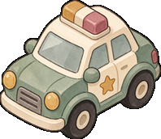

# 道具最终效果约束｜雾色暖光绘本

目标：放回游戏原尺寸，首先读到物件形状，然后是材质和款式。参考车的灰绿车身与奶油色车顶有明确分区，灯和星形只占小面积；车窗靠一块淡反光区别于车漆，轮胎靠更暗的哑光面区别于玻璃。其他物品沿用这套画法，不复制汽车配件。

| 项目 | 画法 | 原尺寸验收 |
| --- | --- | --- |
| 轮廓与款式 | 以对应原图定形。保留原宽高、数量、朝向、支点、镂空及抗锯齿。只在轮廓内部换款，例如裤袋拼接或罐身标签。 | 叠看原图不跳位；最终 Alpha 逐像素一致，细部和孔洞没有双边、封堵。 |
| 配色 | 每款抽选合常识且区别于原图的低饱和主辅色。可从灰绿、烟蓝、灰紫、奶油白、燕麦色中选；以小面积赭黄、陶粉等点睛。不同道具可选不同色，同款多视图用同一套。 | 色块靠色相和明度分得开。缩小看不能只剩鲜亮包装或局部亮斑，也不能整件罩黄或发灰。 |
| 线条 | 外缘沿用纯黑细线；厚度以原尺寸为准。窗框、缝线、折口等内部结构用比邻近色面略深的暖灰、灰褐或同色系暗线，轮廓比内部线清楚。 | 黑线以纯黑为线色，边缘按覆盖面积自然过渡；生成时直接形成平滑弧线和斜线。黑线在生成时完成，恢复画布时等比抗锯齿缩放一次，不补黑边。原尺寸检查斜线、圆弧及小孔，不得出现断线、阶梯或双边。浅色部件有边界，内部不过分描黑。看得见五官、扣子、拉环，不出现粗圈。 |
| 光影 | 用一处柔和暖光。每块材料先铺中间色，再加宽而轻的亮面和转折阴影；遮挡缝隙可略深。 | 体积圆润；亮面不刺白、暗面不死黑。哑光材料无镜面高光，玻璃、金属允许少量清晰反光。 |
| 表面 | 大色面平滑，允许像参考车身一样极轻的局部色差。用少数布褶、接缝、折面或宽反光区别材质。 | 原尺寸干净，无彩铅排线、可见纸粒、磨砂噪点和密集斑点；也不能靠模糊掩盖细节。 |
| 交付 | 单帧、同名、原尺寸透明 PNG，无背景、文字、水印、地面或投影。 | 与本地画风示例及对应原图对照，在浅底与深底上检查线条、色面和透明边缘，技术通过后标记待验收。 |
